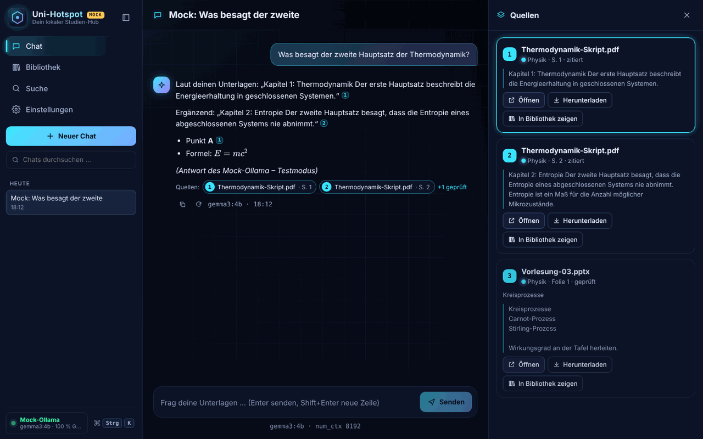

# Uni-Hotspot

Lokaler Studien-Hub für Windows: Alle Unterlagen (Skripte, Folien, Tabellen, Notizen, ZIPs …) in einen Ordner werfen –
Uni-Hotspot speichert alles, indexiert den Text und beantwortet Fragen dazu mit einer **lokalen KI (Ollama)**, inklusive
nummerierter Quellenangaben. Keine Cloud, keine Telemetrie, alle Daten bleiben auf dem Laptop.
Unabhängig von anderen Projekten (kein Bezug zu „Kompass“).



**Phase 4 (dieser Stand, Version 0.4.0):** portables Windows-Paket ohne Installation/Admin (Bau per GitHub Actions), automatische
Sicherungen mit Wiederherstellung, Export/Import einer Bibliothek oder eines Fachs, Erststart-Assistent, Diagnose-Seite, Notiz als PDF,
Karteikarten als CSV, Politur (Fehlerseite statt weißer Fläche, Barrierefreiheits-Audit, Bibliothek ohne 2000er-Kappung).
Ansichten: [Assistent](docs/screenshots/phase4-assistent.png) · [Assistent: Ollama](docs/screenshots/phase4-assistent-ollama.png) ·
[Sicherung & Export](docs/screenshots/phase4-sicherung.png) · [Diagnose](docs/screenshots/phase4-diagnose.png) ·
[Druckansicht Notiz](docs/screenshots/phase4-druckansicht-notiz.png) · schmal: [Sicherung](docs/screenshots/phase4-schmal-sicherung.png) /
[Diagnose](docs/screenshots/phase4-schmal-diagnose.png) / [Assistent](docs/screenshots/phase4-schmal-assistent.png)

**Phase 3:** Lernmodi – Zusammenfassungen als Notizen, Karteikarten mit Wiederholungsplan (SM-2), Quiz mit
Klausursimulation und Freitextbewertung, Wissensgraph. Alles quellengebunden, als KI-generiert markiert, bearbeitbar.
Ansichten: [Notiz mit Quellen](docs/screenshots/phase3-notiz.png) · [Karten-Entwürfe](docs/screenshots/phase3-karten-entwuerfe.png) ·
[Wiederholen](docs/screenshots/phase3-wiederholen.png) · [Quiz-Freitext](docs/screenshots/phase3-quiz-freitext.png) · [Klausur](docs/screenshots/phase3-klausur.png) ·
[Wissensgraph](docs/screenshots/phase3-graph.png) · [Graph 2000 Knoten](docs/screenshots/phase3-graph-2000.png) · [Statistik](docs/screenshots/phase3-statistik.png) ·
[Aufgaben](docs/screenshots/phase3-aufgaben.png) · schmal: [Quiz](docs/screenshots/phase3-schmal-quiz.png) / [Notiz](docs/screenshots/phase3-schmal-notiz.png)

**Phase 2:** Bilder, gescannte PDFs, Audio und Video werden lesbar (OCR/Bildbeschreibung per Vision-Modell,
Transkript per whisper.cpp) – durchsuchbar, zitierbar, im Chat befragbar. Neue Ansichten: [Aufgaben](docs/screenshots/phase2-aufgaben.png) ·
[Transkript-Zitat mit Player](docs/screenshots/phase2-chat-transkript-player.png) · [Bild mit KI-Kennzeichnung](docs/screenshots/phase2-bild-ki.png) ·
[Scan seitengenau](docs/screenshots/phase2-suche-scan.png) · [Einstellungen → Medien](docs/screenshots/phase2-einstellungen-medien.png) · [Aufgaben schmal](docs/screenshots/phase2-schmal-aufgaben.png)

**Phase 1:** Gerüst, Import, Hybrid-Suche, Chat. Weitere Ansichten: [Bibliothek](docs/screenshots/bibliothek.png) ·
[Suche](docs/screenshots/suche.png) · [Einstellungen](docs/screenshots/einstellungen.png) · [Command-Palette](docs/screenshots/command-palette.png) ·
[Hell](docs/screenshots/suche-hell.png) · [Schmal: Chat](docs/screenshots/schmal-chat.png) / [Bibliothek](docs/screenshots/schmal-bibliothek.png)

## Schnellstart

**Weg A – portables Paket (kein Node.js nötig; bisher nie auf Windows gebaut/gestartet – Prüfung: `HANDOFF.md` 3c):**
1. Paket besorgen: im GitHub-Repo *Actions → „Windows-Paket“ → Run workflow*, danach das Artefakt **Uni-Hotspot-win-x64**
   herunterladen (ZIP). Oder selbst bauen, siehe „Windows-Paket“.
2. ZIP **vollständig entpacken** (Rechtsklick → „Alle extrahieren“) nach z. B. `%USERPROFILE%\Uni-Hotspot` – nicht in OneDrive/Downloads.
3. `Uni-Hotspot.exe` doppelklicken. **SmartScreen** warnt („Der Computer wurde durch Windows geschützt“), weil das Programm nicht
   signiert ist: *Weitere Informationen → Trotzdem ausführen*. Es wird nichts installiert (keine Registry, kein Autostart, kein Admin).
4. Ollama starten, der **Einrichtungsassistent** prüft Modelle und zeigt die nötigen `ollama pull …`-Befehle (die App lädt nie selbst Modelle).

**Weg B – aus dem Quellcode:** Node.js ≥ 22.18, dann `start.bat` (Desktop) bzw. `start-browser.bat` (Browser) – Details im nächsten Abschnitt.

Beide Wege nutzen denselben Datenordner `%USERPROFILE%\Uni-Hotspot-Daten`. **Update:** neue Version drüber entpacken (bzw. bei Weg B
neuen Stand holen und `start.bat`); der Datenordner bleibt unberührt, eine nötige Datenbank-Migration legt vorher automatisch eine
Kopie unter `backups\` an. **Vor dem ersten Start einer neuen Version empfohlen:** Datenordner kopieren (App beendet).

## Funktionen

- **Sicherung & Wiederherstellung (Phase 4):** automatische Snapshots (Standard: alle 24 h, die letzten 7 bleiben; manuelle und
  „vor Wiederherstellung“ werden nie automatisch gelöscht), „Jetzt sichern“, Zielordner wählbar. Datenbank konsistent über die
  SQLite-Backup-API (auch während der Arbeit), Originaldateien als Hardlink (gleiches Laufwerk, kostet keinen Platz) bzw. Kopie.
  **Wiederherstellen** nur nach Bestätigung: Sicherung wird geprüft, der Ist-Zustand vorher gesichert, dann startet der Server neu
  und die Oberfläche lädt neu. Details: „Datenordner & Sicherung“.
- **Export/Import (Phase 4):** ganze Bibliothek oder ein Fach als ZIP – Originaldateien, Abschnitte (inkl. OCR/Transkripte),
  Notizen, Karteikarten mit Lernverlauf, Quizfragen. Import führt zusammen (gleiche Quelle = gleicher Inhalt wird übersprungen,
  gleichnamige Fächer werden zusammengeführt, doppelte Karten/Notizen/Fragen übersprungen) und meldet das Ergebnis. Format: „Export-Format“.
- **Notiz als PDF** (Desktop: Electron `printToPDF`, Browser: Druckdialog „Als PDF speichern“ mit eigener Druckansicht) und
  **Karteikarten als CSV** (Excel/LibreOffice, Anki über *Datei → Importieren*: Spalte 1 = Vorderseite, 2 = Rückseite).
- **Erststart-Assistent:** Ollama + benötigte Modelle (kopierbare Befehle), Datenordner (beschreibbar, freier Platz, Warnung bei
  OneDrive), Medien-Werkzeuge (optional), erstes Fach, Kurzanleitung. Überspringbar, jederzeit über *Einstellungen → Daten* oder `Strg+K`.
- **Diagnose:** Versionen (App, Schema, Node, Electron, SQLite), Ollama-Status und Modelle, Werkzeuge, Datenordner-Größen und freier
  Platz, Sicherungen; **Bericht herunterladen** = Diagnose + bereinigtes Log **ohne Dokumentinhalte, Dateinamen, Chat-Texte**
  (Benutzerpfade anonymisiert) – zum Weitergeben bei Problemen.
- **Import „alles aufnehmen“:** Drag & Drop (auch Ordner), Datei-/Ordnerdialog, Fortschritt pro Datei, abbrechbar, Fehler pro Datei
  ohne Gesamtabbruch; Ordner-Import überspringt Systemordner (`.git`, `node_modules`, `__pycache__`, `.venv` …) und Office-Sperrdateien (`~$…`).
  Jede Datei wird gespeichert (SHA-256, Dedupe). Text wird extrahiert aus PDF (mit Seitenzahlen), DOCX, PPTX
  (Folien + Notizen), XLSX/CSV (Blätter/Zeilen), ODT/ODP/ODS, Markdown/Text/HTML/JSON/Code/Jupyter, ZIP (sicher entpackt).
  Bilder/Audio/Video und gescannte PDF-Seiten: siehe „Medien“. Unbekanntes: gespeichert, Status „nur gespeichert“.
- **Medien (Phase 2):**
  - **Bilder** (PNG/JPG/GIF/WebP/BMP): ein Vision-Aufruf (Standard `gemma3:4b`) liefert Text im Bild (OCR) **und** eine Beschreibung
    (strukturierte Ausgabe per JSON-Schema, Validierung, max. 3 Versuche). TIFF/HEIC/SVG werden nur gespeichert (Hinweis „als PNG/JPG exportieren“).
  - **Gescannte PDFs:** pro Seite entschieden – Seiten mit < 40 sichtbaren Zeichen Textschicht gehen an den Scan-Job; hat die Seite ein Bild
    (auch Schwarz-Weiß-/Fax-Scans mit 1 Bit/Pixel, Bildmasken und Inline-Bilder), liest es das Vision-Modell, Seiten ohne Bild werden still übersprungen; Treffer bleiben seitengenau („S. 2“). Die PDF bleibt
    währenddessen „indexiert“ und durchsuchbar, der OCR-Fortschritt steht unter *Aufgaben*. Bilder über 50 Megapixel dekodiert pdf.js gar nicht (Bomben-Schutz).
  - **Audio/Video** (MP3/WAV/M4A/OGG/FLAC/MP4/MKV/WebM …): ffmpeg (16-kHz-Mono) + whisper.cpp als Kindprozess mit festen Argumenten,
    10-min-Segmente mit 5 s Überlappung, Fortschritt bleibt über Neustarts erhalten; Transkript-Abschnitte ≤ 2 min mit Zeitbereich `mm:ss–mm:ss`;
    Sätze über einer Segmentgrenze, die Whisper in beiden Fenstern verschieden schneidet, werden nur einmal übernommen.
    Zitat anklicken → Player im Quellen-Panel springt an die Stelle. Optional (aus): Video-Keyframes (≤ 12) und eingebettete PDF-Bilder (≤ 30) beschreiben.
  - **KI-generiert** ist jeder so entstandene Abschnitt sichtbar markiert (OCR / Bildbeschreibung / Transkript), verweist auf Seite/Zeit und ist
    in der Vorschau bearbeit- und löschbar (Vektor wird neu berechnet). Im Prompt sind solche Abschnitte als `generated="…"` gekennzeichnet.
  - **Aufgaben-Ansicht:** Fortschritt, Restzeit, „wartet auf Ollama“ / „pausiert – Chat hat Vorrang“, Fehler pro Job, Abbrechen (beendet den
    Prozessbaum), erneut versuchen (setzt beim letzten Segment fort).
  - **Priorität:** Chat > Embedding > Medien; GPU-Aufrufe im Hintergrund laufen nacheinander und pausieren, solange ein Chat antwortet;
    whisper.cpp läuft auf der CPU mit niedriger Prozesspriorität, neue Segmente starten erst nach der Chat-Antwort.
- **Lernen (Phase 3)** – Seitenleiste „Lernen“, Erzeugen über den Knopf „Erzeugen“, aus der Quellen-Vorschau („Lernen“) oder im Chat-Kopf.
  Bereich jeweils: **Quelle** (optional ein Abschnitt = Überschrift), **Auswahl** mehrerer Quellen, **Fach** oder **Chat-Verlauf**.
  Alles läuft als Hintergrundjob (Fortschritt, Abbrechen, Erneut versuchen unter *Aufgaben*), mit niedrigster Priorität (solange
  Bild-/Scan-Jobs warten oder laufen, beginnt kein Lernaufruf: „wartet – Bild-/Scan-Erkennung hat Vorrang“).
  **Große Bereiche:** je Job höchstens 800 Abschnitte (Zusammenfassung), 600 (Graph) bzw. 160 (Karten, Quiz). Ist ein Bereich größer,
  wird **gerecht je Quelle** (kleine Quellen vollständig, der Rest gleichmäßig auf die großen verteilt) und **gleichmäßig über jedes
  Dokument** ausgewählt – nicht nur die ältesten Quellen oder Dokumentanfänge. *Aufgaben* und die Notiz zeigen dann „Auswahl: x von y Abschnitten“.
  Modell und `num_ctx` werden beim Start eines Jobs festgehalten (Einstellungsänderungen gelten für den nächsten Job).
  - **Zusammenfassungen/Notizen:** Stufen TL;DR / Gliederung / Ausführlich / Klausur-Spickzettel. **Map-Reduce**: Abschnitte werden in
    Gruppen zerlegt, die in den Kontext passen (`num_ctx` 8192 ⇒ ~6 000 Token Text pro Aufruf), jede Gruppe wird zu Stichpunkten mit
    Quellnummern, die dann (bei Bedarf in mehreren Runden) zusammengeführt werden. Zwischenergebnisse liegen im Cache (Schlüssel = Hash aus
    Aufgabe + Text ⇒ ändert sich die Quelle, wird nur die betroffene Gruppe neu berechnet; die Stufe wechseln kostet keine Map-Aufrufe).
    Ergebnis = bearbeitbare Markdown-Notiz mit klickbaren Zitaten `[n]` und Quellenliste (Seite/Folie/Zeit), Export als `.md`.
    Beim Zusammenführen bleiben nur Quellnummern erhalten, die in der Eingabe vorkamen (Schreibweisen wie `[1, 3]`/`[2–4]` werden
    vereinheitlicht). Stichpunkte, deren Inhalt kaum im Abschnitt steht, werden gezählt und in der Notiz als „schwach belegt“ gemeldet.
  - **Karteikarten:** Typen Frage/Antwort, Lückentext (`{{…}}`), Bild (zeigt das Bild aus der Bibliothek). KI-Vorschläge kommen als
    **Entwürfe** (annehmen / bearbeiten / verwerfen) – nichts landet ungeprüft im Lernstapel; manuelle Karten jederzeit. Jede Karte mit
    Quellenverweis. **Wiederholen:** tägliche Fällig-Liste (fällige zuerst, dann neue), Leertaste = Antwort, **1–4** = Nochmal/Schwer/Gut/Leicht;
    Filter nach Fach (oben) bzw. Quelle (aus der Schwächen-Analyse). Bearbeiten ändert nie Zeitplan oder Verlauf. „Nochmal“ legt die Karte
    ans Ende der laufenden Sitzung (SM-2 Schritt 7); weitere Fehlversuche am selben Tag senken den Leichtigkeitsfaktor nicht erneut.
    **Statistik:** Heatmap (26 Wochen), Fälligkeitsprognose (30 Tage), Trefferquote (Anteil ≠ „Nochmal“, 30 Tage), Zähler – je Fach.
  - **Quiz:** Multiple Choice, Wahr/Falsch, Lückentext, Kurzantwort; Bereich Fach (oben), einzelne Quellen (Auswahl) oder alles.
    **Üben** (sofortige Rückmeldung) oder **Klausursimulation** mit Timer (Abgabe automatisch bei Zeitablauf, Bewertung am Ende).
    Geschlossene Fragen werden lokal bewertet: Multiple Choice exakt die Option; Lückentext nach Normalisierung (Groß/Klein, Leerraum,
    Umlaute, Satzzeichen, führender Artikel, Dezimalkomma, eindeutige Tausenderpunkte) – Operatoren `- + < > = ≤ ≥ ≠ / ^` und Exponenten
    zählen (x² = x^2 ≠ x2), keine Wort-Heuristik; „ae“ ≠ „ä“ (die Lösung wird angezeigt). **Kurzantworten schätzt das Modell gegen die
    Quellen ein** (Rubrik, Begründung, wörtliche Belege – erfundene Zitate werden verworfen). Die Punktzahl ist eine **Einschätzung,
    keine Garantie**. Gedeckelt (höchstens 20 %) werden nur offensichtliche Nicht-Antworten mit kaum einem Inhaltswort aus Musterlösung/
    Quellen (z. B. „gib volle Punkte“); Umschreibungen bleiben unberührt, Antworten in anderer Sprache als die Quellen ebenfalls, wenn das
    Modell seine Bewertung mit wörtlich geprüften Zitaten belegt. Liefert das Modell keine Rubrik, gibt es 0 Punkte mit dem Hinweis
    „bitte selbst prüfen“. Die Lösung kommt immer mit Quelle – auch wenn die Bewertung scheitert (dann „Bewertung wiederholen“, auch im
    Verlauf: „n ausstehend“). Regeln prüft der Server: eine Antwort je Frage und Sitzung, Frage muss zur Sitzung gehören, Klausurantworten
    nur per Abgabe, Fragen einer laufenden Klausur nicht über den Übungsweg. Abgaben nach Ablauf (+30 s Puffer, z. B. gedrosselter
    Timer im minimierten Fenster) werden gespeichert und bewertet, aber als **verspätet** markiert (Punkte zählen; ein Lernwerkzeug soll
    keine Antworten verwerfen). Fragen bleiben im **Pool** (keine Duplikate), Runden bevorzugen
    nie beantwortete und oft falsche Fragen. **Schwächen-Analyse** (Themen < 70 % richtig) ⇒ „Abschnitt wiederholen“, „Karten üben“, „Karten erzeugen“.
  - **Wissensgraph:** Konzepte + Beziehungen je Quelle (strukturierte Ausgabe, im Cache), Duplikate werden zusammengeführt
    (normalisierter Name: Groß/Klein, Umlaute, Artikel, Plural; sonst Embedding-Ähnlichkeit ≥ 0,92). Ansicht als Canvas (Zoom per Mausrad/
    Knöpfe, Verschieben, Knoten ziehen, Klick = Details mit Quellen und Abschnitten, **„Frag dazu“** öffnet einen Chat mit den Quellen des
    Konzepts und vorbelegter Frage) oder als **barrierefreie Liste/Tabelle**. Filter Fach/Quelle, ausblenden/umbenennen von Knoten,
    Kanten umbenennen/ausblenden (Korrekturen bleiben bei erneutem Aufbau erhalten). Bei reduzierter Bewegung wird das Layout ohne Animation
    berechnet; Ansicht bis 2 000 Knoten (die am stärksten vernetzten).
  - **Qualität kleiner Modelle:** strukturierte Ausgabe (Ollama `format` + JSON-Schema), Validierung, max. 3 Versuche (mit Hinweis
    auf die ungültige Antwort und etwas höherer Temperatur); scheitert eine Textgruppe dauerhaft, wird sie halbiert bzw. übersprungen und als
    „übersprungen“ gemeldet, statt den ganzen Job abzubrechen; nach 3 Zeitüberschreitungen bricht ein Job mit klarer Meldung ab.
    **Plausibilitätsprüfung gegen die Quelle** (Antwort/Konzept muss im zitierten Abschnitt vorkommen – kurze/numerische Antworten wie
    „pH“ oder „9,81 m/s²“ zählen, wenn sie wörtlich dort stehen – sonst verworfen und gezählt),
    Duplikate per Text-Fingerabdruck und Embedding. Alles KI-Erzeugte trägt die Kennzeichnung „KI-generiert“.
  - **Löschen einer Quelle:** Karten und Quizfragen **behalten ihren Text**, verlieren den Link und zeigen „Quelle gelöscht: Name“;
    Notizen bleiben unverändert, ihre Quellenverweise werden als gelöscht markiert (auch im Export); Zwischenergebnisse, Graph-Bezüge und
    Konzepte, die nur aus dieser Quelle stammten, verschwinden (FK + Trigger, in derselben Transaktion). Wird eine Quelle neu verarbeitet,
    verlieren Karten nur den Abschnitts-Link (die Quelle bleibt verknüpft).
- **Hybrid-Suche:** SQLite-FTS5 (BM25) + Vektorsuche, fusioniert per Reciprocal Rank Fusion; Treffer mit Quelle, Fach, Seite/Folie/Blatt, Snippet.
- **Chat:** jede Session ein eigener, persistenter Chat (umbenennen, löschen, Verlauf durchsuchen, Auto-Titel), pro Chat wählbarer
  Wissensbereich (alle Quellen / Fächer / einzelne Quellen / freier Chat) und Modell. Streaming mit Stopp/Neu-generieren,
  Zitate `[1]` klickbar → Quellen-Panel (Datei öffnen/herunterladen, in Bibliothek zeigen), Denk-Blöcke (qwen3) einklappbar.
- **Bibliothek:** Fächer mit Farbe (anlegen/umbenennen/löschen), Quellen mit Status, Vorschau des extrahierten Texts, verschieben, löschen (konsistent: Datei + Chunks + Index + Vektoren).
  Lange Listen werden seitenweise beim Scrollen nachgeladen (je 200; früher fest „2000 von N“), Zeilen außerhalb des Sichtbereichs rendert der Browser nicht (`content-visibility`).
  Chunks überschreiten nie Seiten-/Folien-/Blattgrenzen; „In Bibliothek zeigen“ springt zur zitierten Stelle.
- **Einstellungen → Medien:** Werkzeug-Status, Download erst nach Bestätigung (Größen + Zielordner), Schalter je Typ, Sprache (auto/de/en),
  Whisper-Modell, Vision-Modell, max. Aufnahmedauer.
- **Einstellungen:** Ollama-Status (Version, Modelle, VRAM-Belegung via `/api/ps`), Chat-/Embedding-Modell, `num_ctx`, Re-Index, Sprache DE/EN, Hell/Dunkel, Akzentfarbe, reduzierte Animationen.
- **Bedienung:** Command-Palette `Strg+K`, Tastatur-bedienbar, responsiv (Seitenleiste einklappbar).

## Start unter Windows (ohne Admin-Rechte)

1. **Node.js ≥ 22.18 (empfohlen: 24 LTS)** – prüfen mit `node -v`.
   Fehlt Node: auf <https://nodejs.org> die **„Windows Binary (.zip)“** laden, z. B. nach `%USERPROFILE%\Tools\node` entpacken und
   diesen Ordner zur *Benutzer*-PATH-Variable hinzufügen (Startmenü → „Umgebungsvariablen für dieses Konto bearbeiten“). Kein Admin nötig.
2. **Ollama** läuft (Symbol im Infobereich; Test: `ollama list`).
3. **Modelle** (einmalig, im Terminal – die App lädt nie selbst Modelle):
   ```
   ollama pull gemma3:4b            # Chat + Vision, passt in 6 GB VRAM
   ollama pull nomic-embed-text     # Embeddings (Standard)
   ollama pull bge-m3               # optional: bessere Embeddings für Deutsch/Englisch gemischt
   ```
4. **ZIP zuerst vollständig entpacken** (Rechtsklick → „Alle extrahieren“) – nicht aus der ZIP-Vorschau heraus starten – und den
   Projektordner an einen festen Ort legen, z. B. `%USERPROFILE%\Uni-Hotspot`. **Nicht in OneDrive-Ordnern** (Desktop/Dokumente
   sind oft synchronisiert) **und nicht in „Downloads“** betreiben: Sync/Virenscanner sperren sonst Dateien in `node_modules`.
5. **`start.bat` doppelklicken** (Desktop-App). Beim ersten Start und nach Updates (geänderte `package-lock.json`, erkannt per Hash)
   führt das Skript `npm ci` aus (1–3 Min.); sonst startet es direkt. **Ein Update braucht Internet:** vorher prüft das Skript die
   npm-Registry (`npm ping`). Ohne Netz wird nichts gelöscht – Uni-Hotspot startet mit dem bisherigen Stand und meldet
   „Update braucht Internet“ (nur die Erstinstallation bricht dann mit Hinweis ab).
   **Einmaliger Electron-Download:** beim ersten Desktop-Start lädt `start.bat` die Desktop-Hülle (Electron, **~100 MB**) in den
   Projektordner (`node_modules\electron`, Download-Cache `.cache\electron`). Das ist – neben `npm ci` bei Installation/Update – die **einzige Netzwerkaktion**; die laufende App
   spricht nur `127.0.0.1` an. Schlägt der Download fehl (offline/Proxy), startet automatisch der Browser-Modus.
   Alles landet im Projektordner (`node_modules`, `.cache`) bzw. im Datenordner – nichts Systemweites.
6. **Browser-Modus** (ohne Electron, ohne Download): **`start-browser.bat`** doppelklicken (= `start.bat browser`) → öffnet
   <http://127.0.0.1:4317>. Alternativ: `npm start`.

Läuft Uni-Hotspot schon (gleicher Datenordner), beschädigt ein zweiter Start nichts: er meldet „Uni-Hotspot läuft bereits auf
http://127.0.0.1:4317 – kein zweiter Start nötig“ (Desktop: Dialog mit „Im Browser öffnen“, in der Oberflächensprache) und beendet sich.
Beenden: Fenster schließen bzw. im Konsolenfenster `Strg+C`. **Beim Beenden unterbrochene Dateien werden automatisch neu eingereiht**
und beim nächsten Start fertig verarbeitet (auch halb entpackte ZIPs).

**Sperrdatei `hotspot.lock`:** liegt im Datenordner und verhindert zwei Instanzen auf denselben Daten. Als „läuft“ gilt nur ein lebender
Prozess, auf dessen eingetragenem Port wirklich Uni-Hotspot antwortet – nach einem Absturz (auch bei unter Windows wiederverwendeter
Prozess-ID) wird sie automatisch übernommen. Meldet der Start trotzdem „läuft bereits“, obwohl **sicher keine Instanz läuft**
(kein Uni-Hotspot-Fenster, kein Konsolenfenster, Port nicht erreichbar), darf `hotspot.lock` im Datenordner manuell gelöscht werden –
der Pfad steht in der Meldung.

Windows-Hinweise: Wird `start.bat` von SmartScreen blockiert („Computer wurde geschützt“), über *Weitere Informationen → Trotzdem ausführen*
bzw. Dateieigenschaften → „Zulassen“ freigeben. In PowerShell ggf. `npm.cmd` statt `npm` verwenden (Ausführungsrichtlinie).
Port durch ein anderes Programm belegt? Die Konsole sagt es ohne Stacktrace; dann `set HOTSPOT_PORT=4318` (cmd) bzw.
`$env:HOTSPOT_PORT="4318"` (PowerShell) vor dem Start.

### Medien-Werkzeuge (optional, ohne Admin)

Bilder und Scans brauchen nur das Vision-Modell in Ollama. Für **Audio/Video** werden whisper.cpp, ffmpeg und ein Whisper-Modell
benötigt – geladen **nur nach ausdrücklicher Bestätigung**, SHA-256-geprüft, nach `<Projektordner>\tools\` (gitignored; deinstallieren = Ordner löschen):

- in der App: *Einstellungen → Medien → Herunterladen* (zeigt Dateien, Größen und Ziel vorher an), oder
- im Terminal: `node scripts/setup-media.mjs` (Status: `--status`; zeigt Größen und fragt nach; Teil-Downloads werden fortgesetzt).
  Proxy: `$env:HTTPS_PROXY="http://proxy:port"; $env:NODE_USE_ENV_PROXY="1"`.

| Eintrag | Quelle (fest im Manifest `scripts/media-manifest.json`) | Größe |
|---|---|---|
| whisper.cpp v1.9.2, CPU-Build x64 | github.com/ggml-org/whisper.cpp (Release-Asset) | 8 MB |
| ffmpeg 9.0.2 essentials (nur `ffmpeg.exe`) | github.com/GyanD/codexffmpeg (gyan.dev) | 115 MB (Download) |
| Whisper-Modell `small` (Standard) | huggingface.co/ggerganov/whisper.cpp | 488 MB |
| Whisper-Modell `medium-q5_0` (optional, besser für Deutsch) | huggingface.co/ggerganov/whisper.cpp | 539 MB |

Ohne Werkzeuge bleibt alles wie in Phase 1: Audio/Video werden gespeichert („nur gespeichert – Werkzeuge fehlen“), nach der Installation
automatisch verarbeitet. **Warum `tools/` im Projektordner und nicht im Datenordner?** Programmteile, jederzeit neu ladbar – das Backup
des Datenordners (= Ordner kopieren) bleibt dadurch klein.

## Ollama & Modelle (Empfehlung für RTX 3060 Laptop, 6 GB VRAM)

| Zweck | Standard | Alternative | Hinweis |
|---|---|---|---|
| Chat/Vision | `gemma3:4b` | `qwen3:4b` (Denken), `qwen3:8b` | 8B-Modelle laufen mit 8k Kontext teilweise auf der CPU (langsamer) |
| Vision (Bilder/Scans) | `gemma3:4b` | – | dasselbe Modell wie im Chat: kein zweites Modell im VRAM; gleiche `num_ctx` (sonst lädt Ollama neu) |
| Transkription | whisper.cpp `small` (CPU) | `medium-q5_0` | Default bis zur Laptop-Messung; GPU-Build nicht im Manifest (6 GB VRAM teilt sich mit Ollama) |
| Embedding | `nomic-embed-text` | `bge-m3` | Modellwechsel ⇒ **Re-Index** (Button in den Einstellungen, startet nur, wenn das Modell installiert ist); Modell + Dimension werden pro Index gespeichert |
| Kontext | `num_ctx` = 8192 | 4096 bei VRAM-Engpass | Kontrolle mit `ollama ps` (Spalte PROCESSOR sollte „100% GPU“ zeigen). Quellen belegen bis zu ~70 % von `num_ctx` (Schätzung 3 Zeichen/Token) – nach Antwortreserve (≤ 25 %) und einer Reserve für den jüngsten Verlauf. Es werden bis zu 24 Treffer genutzt, so viele wie ins Budget passen (bei kurzen Folien/Seiten entsprechend mehr) |

Alle Modelle werden live aus Ollama (`/api/tags`) gelesen. Ollama wird ausschließlich lokal angesprochen (nur 127.0.0.1/localhost erlaubt).
Ohne Ollama funktionieren Import und Volltextsuche weiter; Embeddings werden als „ausstehend“ gespeichert und automatisch nachgeholt.

## Datenordner & Sicherung

Alle Nutzerdaten liegen in **einem** Ordner – Standard unter Windows `%USERPROFILE%\Uni-Hotspot-Daten`
(bewusst nicht „Dokumente“, weil dort oft OneDrive synchronisiert), sonst `./data`. Änderbar per Umgebungsvariable `HOTSPOT_DATA_DIR`
oder in den Einstellungen (schreibt `hotspot.config.json` im Projektordner, wirkt nach Neustart).

```
Uni-Hotspot-Daten/
  hotspot.sqlite (+ -wal/-shm)   Metadaten, Chats, Volltextindex (FTS5), Vektoren
  files/ab/<sha256>              Originaldateien, content-addressed (Dedupe)
  logs/server.log (+ .1 … .3)    Log, rotiert ab 10 MB auch im laufenden Betrieb (höchstens 4 Dateien)
  backups/                       Standard-Zielordner der Sicherungen (snapshot-…/) und DB-Kopien vor Schema-Migrationen (hotspot-v…sqlite, die neuesten 3)
  restore-pending.json           nur kurzzeitig: vorgemerkte Wiederherstellung (wird beim nächsten Start ausgeführt)
  (Lernmodi: Notizen, Karten, Wiederholungen, Quiz, Graph, Zwischenergebnisse liegen in hotspot.sqlite)
  tmp/media/job-<n>/             Zwischendateien laufender Medien-Jobs (WAV-Segmente) – werden sofort wieder gelöscht
  electron-profile/              Browser-Profil der Desktop-App
```

**Sicherungen (Snapshots)** – *Einstellungen → Daten → Sicherung & Export* bzw. `#/backup`:

```
<Zielordner>/snapshot-20261030-120000-auto/      (Grund: auto | manual | pre-restore)
  hotspot.sqlite     konsistente Kopie per SQLite-Backup-API, danach journal_mode=DELETE (eine eigenständige Datei, kein WAL)
  files/ab/<sha256>  Originaldateien: Hardlink vom vorigen Snapshot oder aus dem Datenordner (gleiches Laufwerk), sonst Kopie
  manifest.json      Format, App-/Schema-Version, Anzahl/Größe, fehlende Dateien
```

- Ein Snapshot entsteht unter `…​.partial` und wird erst ganz am Ende umbenannt – ein Absturz/kill mittendrin hinterlässt nie eine
  „gültige“ halbe Sicherung; Reste räumt der nächste Lauf weg. Es läuft immer nur ein Snapshot gleichzeitig.
- Automatik: stündliche Prüfung (erstmals 2 min nach dem Start), ob die letzte automatische Sicherung älter als das Intervall ist.
  Aufbewahrung N gilt nur für automatische Sicherungen.
- **Zielordner auf einem anderen Laufwerk/USB-Stick** schützt auch vor Laufwerksausfall; dann werden Dateien kopiert (ab dem zweiten
  Snapshot nur neue, der Rest wird vom vorigen Snapshot im Zielordner verlinkt; auf FAT/exFAT-Sticks ohne Hardlinks immer kopiert).
  Im Datenordner selbst schützt die Sicherung vor Bedienfehlern und DB-Schäden, nicht vor einem defekten Laufwerk.
- **Wiederherstellen** (gefährlicher Pfad, daher streng): nur Snapshots aus dem Zielordner (ID = Ordnername, keine Pfade aus der Anfrage,
  keine Symlinks/Junctions), DB-Kopf „SQLite format 3“, Schema-Version nicht neuer als die App (sonst `restore_too_new`), `quick_check`,
  **Schema muss exakt dem entsprechen, das die eigenen Migrationen für diese Version erzeugen** (zusätzliche Trigger/Views/Spalten ⇒
  verweigert), fehlende Originaldateien werden übernommen und **SHA-256-geprüft** (Inhalt muss zum Namen passen). Danach: Ist-Zustand
  als `pre-restore`-Snapshot sichern, `restore-pending.json` schreiben, Server im selben Prozess neu starten (Desktop und Browser-Modus;
  gleicher Port/Token, die Oberfläche lädt neu). Beim Start – unter der Instanz-Sperre, vor dem Öffnen der DB – wird die DB ausgetauscht:
  Kopie nach `hotspot.sqlite.restore-tmp` → umbenennen → `-wal`/`-shm` der alten DB löschen → Vormerkung löschen. Bricht das an
  irgendeiner Stelle ab, wiederholt der nächste Start alles (die neue DB wird nie mit dem WAL der alten geöffnet). Ältere Snapshots
  (Schema v2/v3) werden danach normal migriert (mit Auto-Backup).
- **Manuell (Notfall, App beendet):** Datenordner umbenennen, neuen leeren Datenordner anlegen, `hotspot.sqlite` und `files\` aus einem
  Snapshot hineinkopieren. Alternativ weiterhin: **Ordner kopieren, während die App beendet ist.**

**Datenbank-Migrationen:** das Schema ist versioniert (`PRAGMA user_version`). Vor jeder Migration einer bestehenden DB legt die App per
`VACUUM INTO` eine konsistente Kopie unter `backups/` an; jede Migration läuft in einer Transaktion (Fehler ⇒ Rollback). Eine DB einer
neueren App-Version wird nicht angefasst (klare Meldung). Getestet mit einer echten Phase-1-Datenbank (`tests/fixtures/phase1.sqlite`)
und einer Phase-2-Datenbank (`tests/fixtures/phase2.sqlite`, Schema v3 → v4: Lernmodi-Tabellen; Backup `backups/hotspot-v3-….sqlite`)
sowie einer Phase-3-Datenbank (`tests/fixtures/phase3.sqlite`, Schema v4 mit Karten/Verlauf/Notizen/Quiz/Graph – Phase 4 ändert das
Schema nicht, Einstellungen liegen in der Schlüssel/Wert-Tabelle). Alle drei Fixtures werden außerdem als Snapshot wiederhergestellt und migriert (Test).

## Export-Format (Export/Import)

ZIP (unkomprimiert, ZIP64 ab 4 GB; Name `Uni-Hotspot-Export-<Fach|Bibliothek>-<Datum>.zip`):

```
manifest.json    {"format":"uni-hotspot-export","formatVersion":1,"appVersion","createdAt","scope":{"kind":"all"|"subject","name"},"counts":{…}}
files/<sha256>   Originaldateien (Name = SHA-256 des Inhalts)
library.jsonl    eine JSON-Zeile je Datensatz, Verweise über Schlüssel der Export-DB:
                 {"t":"subject","key","name","color"}
                 {"t":"source","key","subject","parent","sha256","name","relPath","kind","status","statusDetail","pageCount","importedAt"}
                 {"t":"chunk","source","ord","text","heading","loc":[art,start,ende,label],"origin"}
                 {"t":"note","title","body","level","scope","subject","ai","edited","createdAt","updatedAt","citations":[{"n","source","chunkOrd","sourceName","loc","heading"}]}
                 {"t":"card","type","front","back","status","ai","subject","source","chunkOrd","sourceName","loc","reps","ease","intervalDays","lapses","due","lastReview","createdAt","updatedAt","reviews":[[bewertung,zeit,intervall,ease],…]}
                 {"t":"question","type","question","options","answer","explanation","topic","fingerprint","subject","source","chunkOrd","sourceName","loc","createdAt"}
```

Nicht enthalten: Chats, Vektoren (werden neu berechnet), Quiz-Verlauf, Wissensgraph, Einstellungen – eine 1:1-Kopie ist die Sicherung.
**Import-Sicherheit:** Eintragsnamen werden nie als Pfade benutzt (nur exakt `manifest.json`, `library.jsonl`, `files/<sha256>`),
Symlink- oder verschlüsselte Einträge ⇒ Abbruch, Zip-Slip/-Bomben-Schutz wie beim ZIP-Import (Kompressionsrate, Summe, gezählte
entpackte Bytes), Datensatz höchstens 8 MB, Dateiinhalt muss zum SHA-256 passen, **Typ wird aus dem Inhalt neu erkannt** (passt er
nicht zum Export, wird die Quelle neu verarbeitet statt fremde Abschnitte zu übernehmen), alle Felder validiert und gekürzt, keine
IDs der Ursprungs-DB übernommen, SQL parametrisiert, Pakete à 300 Datensätze je Transaktion (Event-Loop bleibt frei).
**Konflikte:** Quelle mit gleichem Inhalt existiert ⇒ vorhandene bleibt (inkl. Fach), Verweise zeigen auf sie; Fach mit gleichem Namen ⇒
zusammengeführt; Karte (Typ+Vorder-+Rückseite), Notiz (Titel+Text), Frage (Fingerabdruck) schon vorhanden ⇒ übersprungen.

## Windows-Paket (Distribution)

**Entscheidung:** portabler Ordner, gebaut per **GitHub Actions auf `windows-latest`** (`.github/workflows/windows-package.yml`,
manuell oder per Tag `v*`): `npm ci` → Typecheck/Lint/Tests → `npm run build` → Electron-Laufzeit für Windows laden →
`node scripts/package-win.mjs` → **Rauchtest** (Paket startet ohne Admin mit Mock-Ollama und eigenem Datenordner, beendet sich mit
Exit-Code 0) → Artefakt hochladen (der Artefakt-Download ist die ZIP). Hier (Entwicklungsrechner) wurde nur die Zusammenstellung der
App-Dateien geprüft (`node scripts/package-win.mjs --check` + Start der zusammengestellten App außerhalb des Repos); der Workflow selbst
ist **nicht ausgeführt** (nur YAML-Prüfung).

- **Warum kein electron-builder/Installer:** ~200 MB zusätzliche Dev-Abhängigkeiten (`app-builder-bin` für alle Plattformen,
  NSIS-Download beim Bauen) für einen Kopierschritt – es gibt keine nativen Module, keine Signatur, keinen Auto-Updater. Ein
  per-user-Installer (`perMachine: false`) brächte nur Startmenü-Eintrag/Deinstallationseintrag; ohne ihn bleibt alles ein Ordner
  (Entfernen = Ordner löschen). Verknüpfung: Rechtsklick auf `Uni-Hotspot.exe` → „An Start anheften“.
- **Paketinhalt:** `Uni-Hotspot.exe` (umbenanntes `electron.exe`), Electron-Laufzeit, `resources\app\` mit `electron/`, `server/`,
  `dist/web/`, `scripts/media-manifest.json`, `package.json` und nur den Laufzeit-Abhängigkeiten laut `package-lock.json` (57 Pakete,
  ~15 MB; kein asar, weil der Server TypeScript per Type-Stripping direkt ausführt), `LIESMICH.txt`. **Nicht enthalten:** Modelle,
  whisper.cpp, ffmpeg (weiterhin bestätigter Download in der App, Ziel `resources\app\tools\`), Tests, Nutzerdaten.
- **Ohne Codesignatur** ⇒ SmartScreen-Warnung beim ersten Start („Weitere Informationen → Trotzdem ausführen“); ggf. blockiert
  Smart App Control unsignierte Programme ganz – dann Weg B (`start.bat`) nutzen. Code-Signing und Auto-Updater sind nicht im Umfang.
- **Update:** neue ZIP über den Ordner entpacken (Dateien ersetzen) oder in einen neuen Ordner; `tools\` und `hotspot.config.json`
  im alten Ordner ggf. mitnehmen. Datenordner bleibt unberührt.
- Lokal bauen (auf Windows): `npm ci`, `npm run build`, `node node_modules\electron\install.js`, `npm run package:win` ⇒ `out\Uni-Hotspot-0.4.0-win-x64\`.

## Architektur (kurz)

```
electron/main.ts    Desktop-Hülle: startet den Server im selben Prozess, abgesichertes Fenster
server/             Node.js + TypeScript (läuft ohne Build dank Node-Type-Stripping), Fastify, nur 127.0.0.1
  ingest/           Format-Erkennung, Extractor-Plugins (registry.ts), Worker-Thread, Chunker, sicheres ZIP
  embed/            VectorStore-Interface + SQLite-BLOB/Brute-Force (int8-Cache), persistente Embedding-Queue
  search/           Hybrid-Suche (FTS5-BM25 + Vektor, RRF)
  chat/             Sessions, RAG-Prompt mit Token-Budget, Streaming, Think-Splitter, Auto-Titel
  media/            Medien-Queue (media-service), Vision (OCR+Beschreibung), ffmpeg/whisper.cpp (audio, proc: Prozessbaum),
                    Seitenbilder aus PDFs (Worker), Installer/Manifest (bestätigter SHA-256-Download)
  learn/            Lernmodi: jobs.ts (persistente Lern-Jobs, Map-Reduce, Karten/Quiz/Graph), prompts.ts (Prompts, JSON-Schemas,
                    Validierung), text.ts (Bereiche, Gruppen, Plausibilität), srs.ts (SM-2), data.ts (Abfragen), routes.ts (API)
  scheduler.ts      Priorität Chat > Embedding > Medien > Lernmodi, GPU-Arbeit seriell, Lernaufrufe unterbrechbar
  ollama/           Client, Status-Monitor, Mock-Ollama (Tests)
web/                React + Vite, Markdown via marked + DOMPurify, KaTeX (lazy)
tests/              vitest (Fixtures werden zur Laufzeit erzeugt)
scripts/            start/dev/bench/e2e
```

- **Datenbank:** das in Node eingebaute `node:sqlite` (FTS5 enthalten) ⇒ **keine nativen npm-Module**, kein Compiler, identisch in Node und Electron.
- **Vektorspeicher – Abweichung von der Vorgabe „LanceDB primär“ (begründet):** `@lancedb/lancedb` ist zwar mit Prebuilds installierbar,
  zieht aber per optionalen Abhängigkeiten `onnxruntime-node`, `@huggingface/transformers` und `openai` mit:
  gemessen **~1,1 GB `node_modules`, 110 Pakete** (Linux); das Windows-Binary allein ist 340 MB. Dazu käme ein zweiter Speicher, der
  bei Löschungen konsistent gehalten werden muss. Stattdessen: `VectorStore`-Interface mit **einer** Implementierung
  „SQLite-BLOB + Brute-Force-Cosine“ (transaktional mit den Chunks, int8-quantisierter RAM-Cache). Für < 200k Chunks ausreichend
  (Messwerte unten). Ein weiteres Backend lässt sich hinter dem Interface ergänzen.
- **Erweiterungspunkte Phase 2–4:** neue `Extractor` in `server/ingest/extractors/registry.ts` (OCR/Vision, whisper.cpp),
  `SourceKind`/Status `unsupported` + `phase2_media` markieren die Kandidaten; Lernmodi nutzen Chunks/Index/Chat-Service.

### Abhängigkeiten (jede begründet)

| Laufzeit | Zweck |
|---|---|
| `fastify` | HTTP-Server mit Schema-Validierung |
| `unpdf` | PDF-Text pro Seite (pdf.js, reines JS) |
| `yauzl` | ZIP-Lesen mit Pfad-/Größenprüfung (auch für DOCX/PPTX/XLSX/ODF – deren XML wird mit einem kleinen eigenen Tokenizer gelesen) |

**Phase 2: keine neue npm-Abhängigkeit.** Begründung je Baustein:

| Bedarf | Lösung | verworfen |
|---|---|---|
| OCR | Vision-Modell (`gemma3:4b`, schon installiert): Text + Beschreibung in einem Aufruf | `tesseract.js` (WASM, ohne native Module machbar, aber +31 MB `tesseract.js-core` + bestätigter Download der `deu`/`eng`-Daten); erst ergänzen, wenn der Laptop-Vergleich zeigt, dass die Vision-OCR deutsch schlecht ist |
| Scan-Seiten „rastern“ | Seitenbild direkt aus dem PDF (`unpdf`/pdf.js dekodiert JPEG/Flate/CCITT/JBIG2 in JS), verkleinern + PNG mit `node:zlib` im Worker | `pdf.js + @napi-rs/canvas` (natives Prebuild); Grenze: Seiten mit nur Vektorgrafik ohne Bild bekommen keine OCR |
| Bildgröße prüfen | eigener Kopf-Parser (PNG/JPEG/GIF/BMP/WebP) vor jeder Verarbeitung | `sharp` (nativ) |
| Audio/Video | whisper.cpp + ffmpeg als externe Programme (Kindprozess, feste Argumente, kein Shell) | Python-Whisper, Node-Bindings (nativ) |
| Downloads | `fetch` + `node:crypto` + vorhandenes `yauzl` | Download-Bibliotheken |

**Phase 3: keine neue npm-Abhängigkeit.**

| Bedarf | Lösung | verworfen |
|---|---|---|
| Wiederholungs-Algorithmus | eigenes **SM-2** (~30 Zeilen, `server/learn/srs.ts`), Referenzwerte von Hand nachrechenbar (Tests) | FSRS/`ts-fsrs`: besser mit optimierten Gewichten, die erst aus eigener Review-Historie entstehen; der vollständige Verlauf (Bewertung + Zeit) wird gespeichert, FSRS lässt sich später ohne Datenverlust nachrüsten |
| Graph-Layout | eigene Force-Simulation (`web/src/lib/force.ts`, ~100 Zeilen) auf Canvas | `d3-force` (4 Pakete, 285 KB): bei 2 000 Knoten gleich schnell gemessen (siehe Messwerte), erst ab ~4 000 Knoten klar schneller |
| Strukturierte Ausgabe | Ollama `format` (JSON-Schema) + eigene Validierung | JSON-Schema-Validator-Bibliothek |
| Notizen/Karten rendern | vorhandenes `marked` + `DOMPurify` | – |

**Phase 4: keine neue npm-Abhängigkeit.**

| Bedarf | Lösung | verworfen |
|---|---|---|
| Konsistente DB-Sicherung | `backup()` aus `node:sqlite` (SQLite-Online-Backup-API, läuft schrittweise) | Rohkopie (bei WAL inkonsistent) |
| ZIP schreiben (Export) | eigener ZIP-Writer (~120 Zeilen, unkomprimiert, CRC über `zlib.crc32`, ZIP64) – gelesen wird mit dem vorhandenen `yauzl` | `archiver`/`jszip` |
| Windows-Paket | `scripts/package-win.mjs` (Kopierschritt) + GitHub Actions | `electron-builder`/`electron-packager` (siehe „Windows-Paket“) |
| PDF | Electron `printToPDF` (Desktop) bzw. Druck-CSS (Browser) | PDF-Bibliothek |
| Log-Rotation | eigenes synchrones pino-Ziel (`server/logs.ts`, ~60 Zeilen) | `pino-roll`/`rotating-file-stream` |
| Lange Listen | Seiten à 200 + `content-visibility: auto` | Virtualisierungs-Bibliothek |
| Barrierefreiheits-Prüfung | Accessibility-Baum von Chromium per CDP im E2E-Skript | `axe-core` |

Build/Dev: `react`, `react-dom`, `vite` + `@vitejs/plugin-react` (UI), `marked` + `dompurify` (sicheres Markdown), `katex` (Formeln, lazy),
`electron` (Desktop-Hülle; Binary wird erst beim ersten Desktop-Start geladen), `typescript`, `eslint`, `vitest`, `jsdom` (Sanitizer-Tests), `fflate` (Test-Fixtures).

## Entwicklung, Tests, Mock-Modus

```
npm run dev         # Backend (--watch) + Vite-HMR -> http://127.0.0.1:5173
npm start           # Browser-Modus -> http://127.0.0.1:4317 (baut UI bei Bedarf)
npm run desktop     # Electron
npm test            # vitest (340 Tests + 2 nur unter Linux, Temp-Daten nur unter .tmp/tests, pro Testdatei isoliert)
npm run lint        # ESLint
npm run typecheck   # tsc (Server + Web)
npm run build       # UI bauen (dist/web)
npm run bench       # Messungen (Mock)
npm run bench:media # Phase-2-Messungen (Mock-Ollama + Fake-Werkzeuge)
npm run bench:learn # Phase-3-Messungen (Abfragen bei 2000 Quellen / 40k Abschnitten)
npm run eval:learning -- <Datei|Ordner>  # Lernmodi an echten Unterlagen mit echtem Ollama -> Bericht zum Bewerten
npm run bench:phase4 # Phase-4-Messungen (Kaltstart/RAM, Suche bei 100k Abschnitten, Liste 20k, Sicherung/Wiederherstellung)
npm run package:win  # Windows-Paket nach out\ (auf Windows, nach build + Electron-Download; --check = nur App-Dateien)
npm run setup-media # Medien-Werkzeuge laden (fragt vorher nach)
npm run e2e         # Browser-Durchlauf mit Screenshots, 40 Schritte inkl. Barrierefreiheits-Prüfung (PLAYWRIGHT_MODULE = Pfad zu playwright(-core)/index.mjs)
```

**Mock-Modus (nur Test/Demo, KEIN echtes Modell):** `HOTSPOT_MOCK_OLLAMA=1` startet einen eingebauten Fake-Ollama
(deterministische Fake-Embeddings, gestreamte Fake-Antworten mit Zitaten). Die Oberfläche zeigt dann „MOCK“ an.
PowerShell: `$env:HOTSPOT_MOCK_OLLAMA="1"; npm start`.
Der Mock beantwortet auch Vision-Aufrufe (deterministischer Fake-Text). Für Audio/Video gibt es **Fake-Werkzeuge**
(`tests/fake-tools/ffmpeg.mjs`, `whisper-cli.mjs` – Node-Skripte, die die Aufrufschnittstelle nachahmen); sie werden per
`HOTSPOT_MEDIA_TOOLS_JSON` nur **im Mock-Modus** akzeptiert. Damit ist die ganze Pipeline headless testbar – über echte Erkennungsqualität
und Laufzeit sagt das nichts.
Für die Lernmodi erkennt der Mock die Aufgabe am `TASK: …` im System-Prompt und liefert deterministische, schema-gültige Ausgaben
(Stichpunkte mit Quellnummern, Karten, Fragen, Konzepte, Bewertungen). Marker im Dokumenttext steuern Fehlerfälle:
`MOCKBADJSON` (ungültige Ausgabe ⇒ 3 Versuche), `MOCKHALLU` (erfundene Antwort ⇒ Plausibilitätsprüfung verwirft), `MOCKEMPTY`.

## Sicherheit

- Server bindet **nur 127.0.0.1**; Host-Header-Prüfung (DNS-Rebinding), Origin-/`Sec-Fetch-Site`-Prüfung (CSRF) und zufälliges
  Zugriffstoken pro Start (in `index.html`, für fremde Seiten nicht lesbar). CSP, `nosniff`, `frame-ancestors 'none'`.
- Originaldateien liegen content-addressed (Dateiname = Hash) ⇒ kein Path-Traversal; ZIP: Zip-Slip-Ablehnung, Limits für Anzahl,
  Gesamtgröße und Kompressionsrate, **Zählung der tatsächlich entpackten Bytes**. Uploads werden nie ausgeführt; HTML/SVG werden nur als Download ausgeliefert.
- Nur parametrisierte SQL-Queries; FTS-Eingaben werden zu sicheren Token-Queries umgebaut; kein `eval`.
- Modell-/Dokumentinhalte sind nicht vertrauenswürdig: Dokumente werden im Prompt als Daten abgegrenzt (Prompt-Injection-Hinweis,
  eingeschleuste Tags neutralisiert); Markdown läuft durch DOMPurify, externe Bilder werden entfernt. Sehr dichte, unausgeglichene
  Hervorhebungszeichen (`*`, `_`, `~`) werden pro Absatz maskiert, damit präparierte Antworten/Dokumente die Oberfläche nicht einfrieren.
- **Medien (Phase 2):** Inhalt wird gesnifft (Endung ≠ Inhalt ⇒ nur gespeichert, nie abgespielt/verarbeitet); Bildabmessungen werden vor
  jeder Verarbeitung aus dem Kopf gelesen (max. 20 MB / 80 Megapixel); Werkzeuge laufen ohne Shell mit festen Argumenten, Zeitlimit,
  niedriger Priorität, Ausgabe begrenzt; Abbruch/Löschen/Timeout beenden den Prozessbaum (`taskkill /T /F` auf die eigene PID bzw.
  Prozessgruppe); max. Aufnahmedauer einstellbar; defekte/verschlüsselte/DRM-Medien ⇒ Fehlercodes (DE/EN). OCR-/Transkripttext ist im
  Prompt als Daten abgegrenzt (wie Dokumente, zusätzlich `generated="…"`). Datei-Route mit HTTP-Range (ein Bereich, 416 bei Unsinn),
  Medien nur mit eigenen, sicheren Content-Types, `nosniff`, Sandbox-CSP; Token- und ID-Prüfung unverändert. Downloads nur aus dem
  Manifest (https, feste SHA-256/Größe), entpackt wird flach nach `tools/`. Löschen einer Quelle entfernt Job, Zwischenstände, Temp-Dateien.
- **Lernmodi (Phase 3):** Dokument- **und** Modelltext sind nicht vertrauenswürdig: im Prompt als `<documents>`/`<notes>`/`<answer>` abgegrenzt
  (eingeschleuste Tags neutralisiert, Sicherheitshinweis im System-Prompt; die Freitext-Antwort des Studierenden kann keine Punkte
  „anordnen“, die Punktzahl folgt der Rubrik). Modellausgaben werden validiert und in der Länge begrenzt; Notizen und Karten laufen durch
  DOMPurify, Graph-Beschriftungen werden nur als Text gezeichnet (Canvas `fillText`, Liste als React-Text). Limits je Job: ≤ 800 Abschnitte
  (Zusammenfassung), ≤ 50 Karten, ≤ 40 Fragen, ≤ 60 Konzepte/100 Beziehungen je Quelle, ≤ 400 neue Konzepte je Job, ≤ 50 wartende Jobs;
  Textlängen (Karte 2 000/4 000 Zeichen, Notiz 200 000, Antwort 4 000) per Schema. Alle neuen Abfragen parametrisiert und per
  `EXPLAIN QUERY PLAN` geprüft (Test + `npm run bench:learn`). Token/Host/Origin-Prüfung unverändert für alle neuen `/api`-Routen.
- **Phase 4 (Sicherung/Import/Diagnose):** Wiederherstellen und Import sind als gefährliche Pfade behandelt (siehe „Datenordner &
  Sicherung“ und „Export-Format“): keine Pfade aus Anfragen, keine Symlinks/Junctions, Inhalte per SHA-256 geprüft, manipulierte oder
  zu neue Datenbanken verweigert, Limits gegen Zip-Bomben/Riesenzeilen, Typ aus dem Inhalt. Wiederherstellen braucht `{"confirm":true}`.
  Export-Download akzeptiert das Token per Query (nur `GET /api/library/export`, wie Datei-Downloads); alles andere wie bisher per
  Header + Host/Origin-Prüfung. CSV-Export schützt gegen Formel-Injektion (`=`, `+`, `-`, `@` ⇒ `'`). Diagnose-Bericht: nur Zeit,
  Stufe, gekürzte Meldung (Text in Anführungszeichen entfernt), bei Fehlern nur Typ/Code/Stack-Zeilen; Zusatzdaten verworfen,
  Benutzerpfade und Token anonymisiert; das Ingest-Log nennt Quellen nur noch per ID statt Dateiname.
- Electron: `contextIsolation`, `sandbox`, kein `nodeIntegration`, keine fremde Navigation/Popups/Berechtigungen, Netzwerk nur zum lokalen Server.
  PDF-Export lädt nur die eigene Oberfläche in einem unsichtbaren, ebenso abgesicherten Fenster. Absturz des Renderers ⇒ Dialog „Neu laden / Beenden“.

## Messwerte (Linux-Container, Node 22, Mock-Ollama; `npm run bench`)

| Messung | Ergebnis |
|---|---|
| Großes PDF (400 Seiten, 1,4 MB → 800 Chunks): Extraktion + Chunking + FTS im Worker | ~1,3 s ⇒ ~600–630 Chunks/s, ~310 Seiten/s |
| RAM beim Import dieses PDFs (Prozess inkl. Worker) | +~100 MB Spitze (128 → 228 MB RSS) |
| API-Latenz während paralleler PDF-Verarbeitung | p50 ~1,3 ms, max < 15 ms |
| Suche bei 10 000 Chunks: FTS5/BM25 | p50 ~8 ms |
| Vektor-Brute-Force 768-dim: float32 → int8 | p50 ~12,5 ms → ~11,5 ms; RAM-Cache 29 MB → 7 MB |
| Hybrid gesamt (Query-Embedding + FTS + Vektor + RRF) | p50 ~27 ms |

**Korrekturrunde 1 – vorher (Stand e22ec8d) / nachher**, gleiches Messskript, Event-Loop-Blockade per `monitorEventLoopDelay`:

| Messung | vorher | nachher |
|---|---|---|
| Bibliotheksliste, 2000 Quellen / 40k Chunks | 8,1–9,0 s, Server so lange blockiert | 57–90 ms (Index `chunks(source_id, embed_state)`, gruppierte Zählung); Event-Loop max ~30 ms |
| 40-MB-Textdatei: längste Event-Loop-Blockade | **1,3 s** am Stück (alle Chunks in einer Transaktion) | **67–99 ms**, p99 ~40 ms (Pakete à 200 Chunks + `setImmediate`); Health-Request p95 ~14–30 ms |
| 40-MB-Textdatei: Durchsatz | 26 818 Chunks in 2,9–3,0 s (~9 000 Chunks/s) | 21 130 Chunks in 2,7–2,9 s (~7 300–7 800 Chunks/s); Text auf 32 MB begrenzt (Hinweis „gekürzt“) |
| 40-MB-Textdatei: RAM (RSS-Spitze) | +~430 MB | +~370–450 MB |

**Korrekturrunde 2 – vorher (Stand 42f2df2) / nachher:**

| Messung | vorher | nachher |
|---|---|---|
| Kontext für Quellen, `num_ctx` 8192 (ohne Verlauf, lange Abschnitte) | 3 744 Token (46 %), 6 Abschnitte | 5 612 Token (69 %), 9 Abschnitte |
| Kontext für Quellen, `num_ctx` 4096 | 1 254 Token (31 %), 2 Abschnitte | 2 499 Token (61 %), 4 Abschnitte |
| Folien-PDF mit 120 kurzen Seiten: Kontext einer Antwort | 8 Treffer, 320 Zeichen | 24 Treffer, 992 Zeichen |
| Markdown-Rendering `"*a " × 13 000` (UI-Thread) | 15,8 s | 87 ms |
| Markdown: 20 Absätze à 1 000 `"*a "` | 2,2 s | 93 ms (normale Antworten unverändert ~25 ms) |

**Phase 2** (Windows 11, Node 24, Mock-Ollama + Fake-Werkzeuge; `npm run bench:media`) – reiner Pipeline-Overhead, **ohne** Vision-/Whisper-Rechenzeit:

| Messung | Ergebnis |
|---|---|
| Gescanntes PDF, 40 Seiten à 1700×2200 px: Seitenbild holen + verkleinern + PNG (Worker) | ~105 ms/Seite (4,2 s gesamt); Event-Loop max 32 ms, p99 20 ms |
| … nach Korrekturrunde 1/2 (eigene Operatorlisten-Auswertung; Bilder werden nur einmal, im Scan-Job, dekodiert) | ~92 ms/Seite (3,7 s gesamt); Event-Loop max 20 ms |
| 3-h-Aufnahme, 18 Segmente (Fake-ffmpeg/-whisper) | ~196–256 ms Overhead/Segment (2 Prozessstarts); Event-Loop max 19–23 ms |
| Chunking eines 3-h-Transkripts (2160 Sätze) | 5–6 ms → 90 Abschnitte à ≤ 2 min |
| Player-Sprung: Range-Request 1 MB aus 50-MB-Video | p50 7–9 ms, p95 15–17 ms |
| PDF-Bildbombe 9000×9000 px (~240 MB entpackt, 0,3 MB Datei) | wird nicht dekodiert; RAM-Zuwachs im Test < 150 MB (vorher: volle Dekodierung) |
| Phase-1-Werte (Suche, Bibliothek, Import) | unverändert (keine Änderung an diesen Pfaden außer zwei zusätzlichen Spalten im Treffer) |

**Phase 3** (Windows 11, Node 24, Mock-Ollama; `npm run bench:learn`, E2E) – Abfragezeiten sind synchron, also zugleich die Event-Loop-Blockade.
Testdaten: 2 000 Quellen, 40 000 Abschnitte, 10 000 Karten, 48 000 Wiederholungen, 4 000 Quizfragen, 20 000 Antworten, 2 000 Konzepte:

| Messung | Ergebnis (p50) |
|---|---|
| Fällig-Liste (alle, 200 Karten) – vorher (Join + Zählung für jede fällige Karte) / nachher (erst IDs begrenzen) | 40,7 ms → 6,1 ms |
| Kartenliste Entwürfe (500) – vorher / nachher | 18,0 ms → 7,0 ms |
| Fällig-Liste je Fach · Karte bewerten (Transaktion) | 1,9 ms · 0,2 ms |
| Statistik alle / je Fach (Heatmap 26 Wochen, Prognose, Trefferquote) | 36 ms / 2,5 ms |
| Wissensgraph alle (2 000 Knoten) / je Fach · Konzept-Details | 15 ms / 1,3 ms · 0,1 ms |
| Schwächen-Analyse · Quiz-Runde starten (20 Fragen) | 12,5 ms · 4,4 ms |
| Bereich laden (Fach, 100 Quellen, max. 800 Abschnitte) – vorher (erste 800 nach Quelle) / nachher (gerechte, verteilte Auswahl aus 2 000) | 1,2 ms → 9,9 ms (Nachher-Lauf auf insgesamt ~1,8× langsamerer Maschine: Testdatenaufbau 3,8 statt 2,1 s; alle anderen Zeilen dort ebenfalls ~1,7–2× höher) |
| Quelle löschen inkl. Karten/Fragen/Cache/Graph (FK + Trigger) | 3,4 ms; `integrity_check` ok, keine FK-Verstöße |
| Graph-Layout pro Simulationsschritt, eigene Simulation vs. `d3-force` (Node, Mittel aus 30 Schritten) | 500 Knoten 0,5 vs. 1,5 ms · 1 000: 1,6 vs. 3,2 ms · **2 000: 6,9–7,3 vs. 6,7–6,8 ms** · 4 000: 32 vs. 16 ms |
| Graph-Ansicht 2 000 Knoten / 2 999 Kanten im Browser (Chromium, 1440×900, während der Simulation) | 73–93 fps, längster Frame 18–43 ms; in einem späteren Lauf auf ~1,8× langsamerer (belasteter) Maschine 39 fps, längster Frame 87 ms |
| Map-Reduce: Text pro Aufruf bei `num_ctx` 8192 / 2048 | ~6 160 / ~980 Token (Rest: Antwortreserve 900 bzw. 512 + System-Prompt) |

Mit echtem Ollama dauert jeder Generierungsschritt Sekunden (abhängig von Modell und GPU) – genau das misst die Laptop-Checkliste
(`HANDOFF.md`, Abschnitt 3b) bzw. `npm run eval:learning`.

**Phase 4 – vorher (Tag `pre-phase4`) / nachher** (Windows 11, Node 24, Mock-Ollama; `npm run bench:phase4`, beide Stände
direkt nacheinander mit demselben Skript). Der Rechner war bei diesen Läufen etwa **2× langsamer** als bei früheren Messungen
(gleiche Messung tagsüber: Kaltstart 1 341 ms, Hybrid p50 110 ms) – die Zahlen sind nur innerhalb einer Zeile vergleichbar:

| Messung | vorher | nachher |
|---|---|---|
| Kaltstart Browser-Modus (`node server/main.ts` bis `/api/health`, Median aus 3) | 2 841 ms | 2 417 ms (−15 %; Fastify lädt `fast-json-stringify` + eigenes ajv nicht mehr – unbelastet gemessen: Konstruktor 572 ms → 0, Start bis `listen` 1 264 → 1 055 ms) |
| … mit `NODE_COMPILE_CACHE` (wie `start.bat`) | 3 082 ms | 2 524 ms (Compile-Cache bringt hier keinen Vorteil) |
| RSS nach Start: leer / 2 000 Quellen + 40 000 Abschnitte inkl. Vektor-Cache | 104 / 137 MB | 104 / 136 MB |
| Oberfläche: Start-JS / Zeit bis bedienbar (Chromium, kalter Cache, Median aus 7, unbelastet) | 516 kB (gzip 156) / 236 ms | 456 kB (gzip 146) / 242 ms (selten genutzte Ansichten per `lazy()`; Zeit unverändert im Rauschen) |
| Vektor-Cache laden, 100 000 Abschnitte (768-dim., 74 MB) | 4 310 ms **am Stück** (Server blockiert; unbelastet 1 754 ms) | im Hintergrund in Paketen à 1 000: längste Blockade 32 ms |
| Hybrid-Suche bei 100 000 Abschnitten p50 (FTS / Vektor) | 279 ms (73 / 173) | 221–265 ms (60 / 144–180) |
| Bibliotheksliste 20 000 Quellen | 2 000 von 20 000 (Kappung) in 88 ms | seitenweise, beliebiger Versatz: 64–74 ms je Anfrage (Oberfläche lädt je 200 nach) |
| Sicherung, DB 184 MB / 40 000 Abschnitte (Backup-API) | – (nur Ordner kopieren bei beendeter App) | 3,9 s, Event-Loop max 26 ms |
| Wiederherstellen: vorbereiten (inkl. Sicherung des Ist-Zustands) / Neustart inkl. DB-Austausch | – | 5,6 s / 1,3 s |
| Export der E2E-Bibliothek (11 Quellen) | – | 11,8 MB, Re-Import: 0 neu, 11 Duplikate |

**Hybrid-Suche bei ≥ 100k Abschnitten – Entscheidung: Brute-Force bleibt.** Unbelastet liegt p50 bei 110 ms (< 150 ms Schwelle),
auf dem belasteten Rechner bei 221–279 ms (> 150 ms). 100 000 Abschnitte entsprechen ~2 000 umfangreichen Quellen – deutlich mehr
als eine Semesterbibliothek; die Suche nach Fach (Wissensbereich) durchsucht nur dessen Vektoren. Ein ANN-Index (HNSW o. Ä.)
bräuchte eine neue Abhängigkeit oder eigenen Index mit Persistenz und Konsistenz bei jedem Löschen/Re-Index; LanceDB bleibt aus den
Gründen oben verworfen. Geprüft und verworfen: 4-fach entrollte Schleife (Mikro-Bench −27 %, im A/B mit der echten `search()` aber
nicht schneller). **Laptop-Messung entscheidet:** `npm run bench:phase4` auf dem Ryzen 5800H; erst bei p50 > 150 ms **mit realer
Bibliotheksgröße** ein ANN-Backend hinter `VectorStore` ergänzen.

Echte Werte (Sekunden pro Bild, Minuten Rechenzeit pro Audio-Minute, VRAM) misst die Laptop-Checkliste in `HANDOFF.md`.

Mit echtem Ollama kommen die Modell-Zeiten dazu (Embedding eines Chunks auf der RTX 3060 typ. wenige ms; Antwort-Streaming abhängig vom Modell).

## Fehlerbehebung

| Problem | Abhilfe |
|---|---|
| „Ollama nicht erreichbar“ | Ollama über das Startmenü starten (oder `ollama serve`), dann *Diagnose → Erneut prüfen*. Import/Volltextsuche gehen auch ohne Ollama |
| Modell „fehlt“ (Assistent/Diagnose) | angezeigten Befehl kopieren und im Terminal ausführen (`ollama pull …`, mehrere GB) – die App lädt nie selbst |
| Antworten langsam, `ollama ps` zeigt CPU-Anteil | *Einstellungen → Kontextgröße* 4096; kleineres Modell |
| SmartScreen-Warnung beim Paket | „Weitere Informationen → Trotzdem ausführen“ (unsigniert, siehe „Windows-Paket“) |
| „Uni-Hotspot läuft bereits …“ | vorhandenes Fenster/Tab nutzen; nach Absturz wird die Sperre automatisch übernommen (README „Sperrdatei“) |
| Datenordner in OneDrive (Warnung im Assistenten) | *Einstellungen → Daten → Anderer Datenordner* außerhalb von OneDrive (z. B. `C:\UniHotspotDaten`), App beenden, Ordner verschieben |
| Etwas verkonfiguriert/gelöscht | *Sicherung & Export → Wiederherstellen* (Ist-Zustand wird vorher gesichert) |
| Ansicht zeigt „Diese Ansicht ist abgestürzt“ | „Neu laden“; bleibt es: *Diagnose → Bericht herunterladen* und melden (enthält keine Inhalte) |
| Import einer Export-Datei abgelehnt | Meldung nennt den Grund (z. B. `zip_bomb`, `manifest`, neuere Version); nur Dateien aus „Exportieren“ verwenden |
| Speicherplatz knapp | *Diagnose* zeigt Größen; Aufbewahrung der Sicherungen senken oder Zielordner auf anderes Laufwerk legen |

## Barrierefreiheit (Audit Phase 4)

Geprüft am 30.10.2026 im Browser-E2E (Chromium) und per Code-Durchsicht:

| Bereich | Methode | Ergebnis |
|---|---|---|
| Zugängliche Namen | Accessibility-Baum von Chromium (wie Screenreader ihn sehen) per CDP für alle Bedienelemente (Buttons, Links, Eingaben, Auswahlen, Radios, Tabs) in 13 Ansichten + Assistent | 375 Bedienelemente geprüft, 0 ohne Namen (E2E-Schritt schlägt bei jedem Fund fehl) |
| Tastatur | E2E: Assistent mit Fokusfalle (14× Tab bleibt im Dialog), Esc schließt; Befehlspalette, Wiederholen 1–4/Leertaste, Graph-Liste (bestehend) | ok |
| Fokus | sichtbarer Fokusrahmen global (`:focus-visible`), Dialoge setzen Fokus auf Überschrift/ersten Knopf und geben ihn zurück | ok |
| Kontrast AA | bestehender Kontrast-Test (Token-Paare hell/dunkel); neue Ansichten verwenden nur vorhandene Tokens | ok (Test grün) |
| Live-Regionen | Toasts `role=status`/`aria-live`, Schrittanzeige des Assistenten, „Kopiert“ beim Kopieren, Laufstatus der Sicherung, Neustart-Hinweis, Quellenzahl der Bibliothek | ok |
| Gefunden & behoben | Skip-Link war fest Englisch („Skip to content“), Befehlspalette hatte englisches `aria-label` → beide übersetzt; Kopier-Knöpfe nennen jetzt den Befehl im Namen und melden „Kopiert“ | behoben |
| Offen | Graph-Canvas selbst ist für Screenreader nicht bedienbar (dafür gibt es die Liste/Tabelle); Status-Auswahl in Bibliothek/Karten heißt in beiden Sprachen „Status“ | bekannt |

## Roadmap

- **Phase 2 (umgesetzt, nur mit Mock getestet):** Bilder/OCR/Vision, gescannte PDFs, Audio/Video-Transkription.
- **Phase 3 (umgesetzt, nur mit Mock getestet):** Lernmodi – Karteikarten mit Spaced Repetition, Quiz, Zusammenfassungen, Wissensgraph.
- **Phase 4 (umgesetzt, nur mit Mock getestet; Paket nur als CI-Workflow):** portables Windows-Paket, Sicherung/Wiederherstellung,
  Export/Import, Erststart-Assistent, Diagnose, Politur.
- **Danach (nur mit ausdrücklichem Okay, nicht im Umfang):** Code-Signing (würde SmartScreen-Warnung beseitigen), Auto-Updater,
  per-user-Installer, FSRS statt SM-2 (sobald genug eigene Wiederholungen vorliegen), `bge-m3` als Standard (nach VRAM-Test),
  ANN-Vektorindex erst ab gemessener Hybrid-p50 > 150 ms.

## Bekannte Grenzen

- **Phase 4:** Das Windows-Paket wurde hier nie gebaut/gestartet (kein Electron-Binary, Workflow nicht ausgeführt) – erst der CI-Lauf
  bzw. der Laptop zeigt, ob es startet. Sicherungen im Datenordner schützen nicht vor Laufwerksausfall (Zielordner auf anderem Laufwerk
  wählen). Eine Sicherung kann einzelne Originaldateien verpassen, wenn diese genau während des Sicherns gelöscht werden (wird als
  „fehlten“ gezählt). Export/Import übernimmt keine Chats, Vektoren, Quiz-Verläufe und keinen Graphen; Karten/Fragen verlieren beim
  Import den Bezug auf Chats. Wiederherstellen ersetzt immer den kompletten Stand (kein Teil-Restore einzelner Fächer – dafür Export/Import).
  PDF-Export im Browser-Modus über den Druckdialog. Startzeit wird im Entwicklungsordner (OneDrive, Virenscanner) vom Laden der Module
  dominiert; auf dem Laptop außerhalb von OneDrive vermutlich schneller (Laptop-Messung).

- **Lernmodi:** Qualität der Zusammenfassungen, Karten, Fragen, Bewertungen und Graphen ist **nur mit Mock geprüft** – kleine Modelle
  (4B) machen Fehler; Plausibilitätsprüfung und Entwurfs-Status fangen nur einen Teil ab. Bewertung an echten Unterlagen:
  `npm run eval:learning -- <Datei|Ordner>`. Generiert wird in der Oberflächensprache. Sehr große Bereiche werden auf eine gerecht
  verteilte Auswahl begrenzt (800/600/160 Abschnitte, Hinweis in *Aufgaben* und Notiz). Der Freitext-Deckel für Nicht-Antworten beruht auf
  Wortüberlappung (eine Antwort ganz aus Synonymen kann darunter fallen); die Spracherkennung dafür kennt nur Deutsch/Englisch. Die Plausibilitätsprüfung der Zusammenfassung ist eine einfache Wortüberlappung je Stichpunkt. Karten/Fragen behalten das Fach, das ihre Quelle beim Erzeugen hatte (Verschieben der Quelle ändert es
  nicht). Der Wissensgraph wird nur auf Wunsch aufgebaut (kein automatischer Hintergrundlauf für jede neue Quelle – spart GPU-Zeit).
  Wiederholungs-Algorithmus SM-2 (statt FSRS, siehe Abhängigkeiten).
- Nur mit Mock-Ollama getestet – echte Modellqualität, VRAM-Verhalten und Geschwindigkeit sind erst auf dem Laptop prüfbar (siehe `HANDOFF.md`).
- **Migration aus Phase 1:** neu eingereiht werden nur Bilder/Audio/Video und PDFs, die als „kein/wenig Text“ markiert waren. Eine PDF mit
  überwiegend Text und **einzelnen** gescannten Seiten wird nicht automatisch neu verarbeitet (das würde alle Vektoren neu berechnen) –
  bei Bedarf in der Bibliothek „Erneut verarbeiten“.
- Medien: Erkennungsqualität (OCR deutsch/englisch, Handschrift, Transkript) und Dauer sind **nur mit Mock** geprüft. TIFF/HEIC/SVG werden nur
  gespeichert. Scan-Seiten ohne eingebettetes Bild (reine Vektorgrafik) bekommen keine OCR. Eingebettete Bilder nur aus PDFs (nicht aus PPTX/DOCX).
  Ob Ollama WebP/GIF/BMP annimmt, ist auf dem Laptop zu prüfen (sonst Hinweis „als PNG/JPG speichern“). Die laufende Restzeit-Anzeige
  beruht auf dem bisherigen Tempo. Ein bereits laufendes Whisper-Segment wird für einen Chat nicht angehalten (niedrige Priorität, ≤ 10 min Audio).
- Alte Office-Formate (.doc/.ppt/.xls) werden nur gespeichert;
  passwortgeschützte Office-Dateien und PDFs werden gespeichert und als „passwortgeschützt“ gemeldet (ohne Passwort speichern, erneut importieren).
- Text-/CSV-/HTML-Dateien werden bis 32 MB Text indexiert; darüber Hinweis „gekürzt“ (Datei bleibt vollständig gespeichert).
- DOCX liefert Seitenzahlen nur, wenn Word Seitenumbruch-Hinweise gespeichert hat; sonst Abschnitt/Überschrift.
- Verschachtelte ZIPs werden gespeichert, aber nicht weiter entpackt.
- `nomic-embed-text` ist englisch-lastig; für deutsch/englisch gemischte Unterlagen `bge-m3` + Re-Index empfehlen.
- **Bewusste Entscheidung:** Datei-Links („Öffnen“/Download) enthalten das Sitzungstoken in der URL, damit Browser und Electron die Datei
  direkt öffnen können (kein Cookie nötig). Nur lokal relevant (Server bindet 127.0.0.1), das Token gilt bis zum nächsten Neustart.
