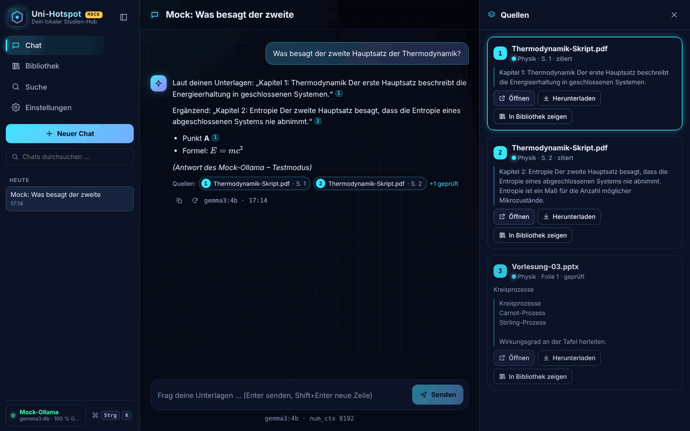

# Uni-Hotspot

Lokaler Studien-Hub für Windows: Alle Unterlagen (Skripte, Folien, Tabellen, Notizen, ZIPs …) in einen Ordner werfen –
Uni-Hotspot speichert alles, indexiert den Text und beantwortet Fragen dazu mit einer **lokalen KI (Ollama)**, inklusive
nummerierter Quellenangaben. Keine Cloud, keine Telemetrie, alle Daten bleiben auf dem Laptop.
Unabhängig von anderen Projekten (kein Bezug zu „Kompass“).



**Phase 1 (dieser Stand):** Gerüst, Import, Hybrid-Suche, Chat. Weitere Ansichten: [Bibliothek](docs/screenshots/bibliothek.png) ·
[Suche](docs/screenshots/suche.png) · [Einstellungen](docs/screenshots/einstellungen.png) · [Command-Palette](docs/screenshots/command-palette.png) ·
[Hell](docs/screenshots/suche-hell.png) · [Schmal: Chat](docs/screenshots/schmal-chat.png) / [Bibliothek](docs/screenshots/schmal-bibliothek.png)

## Funktionen

- **Import „alles aufnehmen“:** Drag & Drop (auch Ordner), Datei-/Ordnerdialog, Fortschritt pro Datei, abbrechbar, Fehler pro Datei
  ohne Gesamtabbruch; Ordner-Import überspringt Systemordner (`.git`, `node_modules`, `__pycache__`, `.venv` …) und Office-Sperrdateien (`~$…`).
  Jede Datei wird gespeichert (SHA-256, Dedupe). Text wird extrahiert aus PDF (mit Seitenzahlen), DOCX, PPTX
  (Folien + Notizen), XLSX/CSV (Blätter/Zeilen), ODT/ODP/ODS, Markdown/Text/HTML/JSON/Code/Jupyter, ZIP (sicher entpackt).
  Bilder/Audio/Video/Unbekanntes: gespeichert, Status „nur gespeichert – Analyse folgt in Phase 2“.
- **Hybrid-Suche:** SQLite-FTS5 (BM25) + Vektorsuche, fusioniert per Reciprocal Rank Fusion; Treffer mit Quelle, Fach, Seite/Folie/Blatt, Snippet.
- **Chat:** jede Session ein eigener, persistenter Chat (umbenennen, löschen, Verlauf durchsuchen, Auto-Titel), pro Chat wählbarer
  Wissensbereich (alle Quellen / Fächer / einzelne Quellen / freier Chat) und Modell. Streaming mit Stopp/Neu-generieren,
  Zitate `[1]` klickbar → Quellen-Panel (Datei öffnen/herunterladen, in Bibliothek zeigen), Denk-Blöcke (qwen3) einklappbar.
- **Bibliothek:** Fächer mit Farbe (anlegen/umbenennen/löschen), Quellen mit Status, Vorschau des extrahierten Texts, verschieben, löschen (konsistent: Datei + Chunks + Index + Vektoren).
  Chunks überschreiten nie Seiten-/Folien-/Blattgrenzen; „In Bibliothek zeigen“ springt zur zitierten Stelle.
- **Einstellungen:** Ollama-Status (Version, Modelle, VRAM-Belegung via `/api/ps`), Chat-/Embedding-Modell, `num_ctx`, Re-Index, Sprache DE/EN, Hell/Dunkel, Akzentfarbe, reduzierte Animationen.
- **Bedienung:** Command-Palette `Strg+K`, Tastatur-bedienbar, responsiv (Seitenleiste einklappbar).

## Start unter Windows (ohne Admin-Rechte)

1. **Node.js ≥ 22.18 (empfohlen: 24 LTS)** – prüfen mit `node -v`.
   Fehlt Node: auf <https://nodejs.org> die **„Windows Binary (.zip)“** laden, z. B. nach `%USERPROFILE%\Tools\node` entpacken und
   diesen Ordner zur *Benutzer*-PATH-Variable hinzufügen (Startmenü → „Umgebungsvariablen für dieses Konto bearbeiten“). Kein Admin nötig.
2. **Ollama** läuft (Symbol im Infobereich; Test: `ollama list`).
3. **Modelle** (einmalig, im Terminal – die App lädt nie selbst Modelle):
   ```
   ollama pull gemma3:4b            # Chat + Vision, passt in 6 GB VRAM
   ollama pull nomic-embed-text     # Embeddings (Standard)
   ollama pull bge-m3               # optional: bessere Embeddings für Deutsch/Englisch gemischt
   ```
4. **ZIP zuerst vollständig entpacken** (Rechtsklick → „Alle extrahieren“) – nicht aus der ZIP-Vorschau heraus starten – und den
   Projektordner an einen festen Ort legen, z. B. `%USERPROFILE%\Uni-Hotspot`. **Nicht in OneDrive-Ordnern** (Desktop/Dokumente
   sind oft synchronisiert) **und nicht in „Downloads“** betreiben: Sync/Virenscanner sperren sonst Dateien in `node_modules`.
5. **`start.bat` doppelklicken** (Desktop-App). Beim ersten Start und nach Updates (geänderte `package-lock.json`, erkannt per Hash)
   führt das Skript `npm ci` aus (1–3 Min.); sonst startet es direkt.
   **Einmaliger Electron-Download:** beim ersten Desktop-Start lädt `start.bat` die Desktop-Hülle (Electron, **~100 MB**) in den
   Projektordner (`node_modules\electron`, Download-Cache `.cache\electron`). Das ist – neben `npm ci` bei Installation/Update – die **einzige Netzwerkaktion**; die laufende App
   spricht nur `127.0.0.1` an. Schlägt der Download fehl (offline/Proxy), startet automatisch der Browser-Modus.
   Alles landet im Projektordner (`node_modules`, `.cache`) bzw. im Datenordner – nichts Systemweites.
6. **Browser-Modus** (ohne Electron, ohne Download): **`start-browser.bat`** doppelklicken (= `start.bat browser`) → öffnet
   <http://127.0.0.1:4317>. Alternativ: `npm start`.

Läuft Uni-Hotspot schon (gleicher Datenordner), beschädigt ein zweiter Start nichts: er meldet „Uni-Hotspot läuft bereits auf
http://127.0.0.1:4317 – kein zweiter Start nötig“ (Desktop: Dialog mit „Im Browser öffnen“) und beendet sich. Beenden: Fenster schließen
bzw. im Konsolenfenster `Strg+C`.

Windows-Hinweise: Wird `start.bat` von SmartScreen blockiert („Computer wurde geschützt“), über *Weitere Informationen → Trotzdem ausführen*
bzw. Dateieigenschaften → „Zulassen“ freigeben. In PowerShell ggf. `npm.cmd` statt `npm` verwenden (Ausführungsrichtlinie).
Port durch ein anderes Programm belegt? Die Konsole sagt es ohne Stacktrace; dann `set HOTSPOT_PORT=4318` (cmd) bzw.
`$env:HOTSPOT_PORT="4318"` (PowerShell) vor dem Start.

## Ollama & Modelle (Empfehlung für RTX 3060 Laptop, 6 GB VRAM)

| Zweck | Standard | Alternative | Hinweis |
|---|---|---|---|
| Chat/Vision | `gemma3:4b` | `qwen3:4b` (Denken), `qwen3:8b` | 8B-Modelle laufen mit 8k Kontext teilweise auf der CPU (langsamer) |
| Embedding | `nomic-embed-text` | `bge-m3` | Modellwechsel ⇒ **Re-Index** (Button in den Einstellungen, startet nur, wenn das Modell installiert ist); Modell + Dimension werden pro Index gespeichert |
| Kontext | `num_ctx` = 8192 | 4096 bei VRAM-Engpass | Kontrolle mit `ollama ps` (Spalte PROCESSOR sollte „100% GPU“ zeigen). Der RAG-Prompt nutzt höchstens ~70 % von `num_ctx` (Schätzung 3 Zeichen/Token), der Rest bleibt für die Antwort |

Alle Modelle werden live aus Ollama (`/api/tags`) gelesen. Ollama wird ausschließlich lokal angesprochen (nur 127.0.0.1/localhost erlaubt).
Ohne Ollama funktionieren Import und Volltextsuche weiter; Embeddings werden als „ausstehend“ gespeichert und automatisch nachgeholt.

## Datenordner & Backup

Alle Nutzerdaten liegen in **einem** Ordner – Standard unter Windows `%USERPROFILE%\Uni-Hotspot-Daten`
(bewusst nicht „Dokumente“, weil dort oft OneDrive synchronisiert), sonst `./data`. Änderbar per Umgebungsvariable `HOTSPOT_DATA_DIR`
oder in den Einstellungen (schreibt `hotspot.config.json` im Projektordner, wirkt nach Neustart).

```
Uni-Hotspot-Daten/
  hotspot.sqlite (+ -wal/-shm)   Metadaten, Chats, Volltextindex (FTS5), Vektoren
  files/ab/<sha256>              Originaldateien, content-addressed (Dedupe)
  logs/server.log                Log (rotiert ab 10 MB)
  electron-profile/              Browser-Profil der Desktop-App
```

**Backup = Ordner kopieren, während die App beendet ist** (SQLite im WAL-Modus).

## Architektur (kurz)

```
electron/main.ts    Desktop-Hülle: startet den Server im selben Prozess, abgesichertes Fenster
server/             Node.js + TypeScript (läuft ohne Build dank Node-Type-Stripping), Fastify, nur 127.0.0.1
  ingest/           Format-Erkennung, Extractor-Plugins (registry.ts), Worker-Thread, Chunker, sicheres ZIP
  embed/            VectorStore-Interface + SQLite-BLOB/Brute-Force (int8-Cache), persistente Embedding-Queue
  search/           Hybrid-Suche (FTS5-BM25 + Vektor, RRF)
  chat/             Sessions, RAG-Prompt mit Token-Budget, Streaming, Think-Splitter, Auto-Titel
  ollama/           Client, Status-Monitor, Mock-Ollama (Tests)
web/                React + Vite, Markdown via marked + DOMPurify, KaTeX (lazy)
tests/              vitest (Fixtures werden zur Laufzeit erzeugt)
scripts/            start/dev/bench/e2e
```

- **Datenbank:** das in Node eingebaute `node:sqlite` (FTS5 enthalten) ⇒ **keine nativen npm-Module**, kein Compiler, identisch in Node und Electron.
- **Vektorspeicher – Abweichung von der Vorgabe „LanceDB primär“ (begründet):** `@lancedb/lancedb` ist zwar mit Prebuilds installierbar,
  zieht aber per optionalen Abhängigkeiten `onnxruntime-node`, `@huggingface/transformers` und `openai` mit:
  gemessen **~1,1 GB `node_modules`, 110 Pakete** (Linux); das Windows-Binary allein ist 340 MB. Dazu käme ein zweiter Speicher, der
  bei Löschungen konsistent gehalten werden muss. Stattdessen: `VectorStore`-Interface mit **einer** Implementierung
  „SQLite-BLOB + Brute-Force-Cosine“ (transaktional mit den Chunks, int8-quantisierter RAM-Cache). Für < 200k Chunks ausreichend
  (Messwerte unten). Ein weiteres Backend lässt sich hinter dem Interface ergänzen.
- **Erweiterungspunkte Phase 2–4:** neue `Extractor` in `server/ingest/extractors/registry.ts` (OCR/Vision, whisper.cpp),
  `SourceKind`/Status `unsupported` + `phase2_media` markieren die Kandidaten; Lernmodi nutzen Chunks/Index/Chat-Service.

### Abhängigkeiten (jede begründet)

| Laufzeit | Zweck |
|---|---|
| `fastify` | HTTP-Server mit Schema-Validierung |
| `unpdf` | PDF-Text pro Seite (pdf.js, reines JS) |
| `yauzl` | ZIP-Lesen mit Pfad-/Größenprüfung (auch für DOCX/PPTX/XLSX/ODF – deren XML wird mit einem kleinen eigenen Tokenizer gelesen) |

Build/Dev: `react`, `react-dom`, `vite` + `@vitejs/plugin-react` (UI), `marked` + `dompurify` (sicheres Markdown), `katex` (Formeln, lazy),
`electron` (Desktop-Hülle; Binary wird erst beim ersten Desktop-Start geladen), `typescript`, `eslint`, `vitest`, `jsdom` (Sanitizer-Tests), `fflate` (Test-Fixtures).

## Entwicklung, Tests, Mock-Modus

```
npm run dev         # Backend (--watch) + Vite-HMR -> http://127.0.0.1:5173
npm start           # Browser-Modus -> http://127.0.0.1:4317 (baut UI bei Bedarf)
npm run desktop     # Electron
npm test            # vitest (120 Tests, Temp-Daten nur unter .tmp/tests, pro Testdatei isoliert)
npm run lint        # ESLint
npm run typecheck   # tsc (Server + Web)
npm run build       # UI bauen (dist/web)
npm run bench       # Messungen (Mock)
npm run e2e         # Browser-Durchlauf mit Screenshots (benötigt eine Playwright-Installation)
```

**Mock-Modus (nur Test/Demo, KEIN echtes Modell):** `HOTSPOT_MOCK_OLLAMA=1` startet einen eingebauten Fake-Ollama
(deterministische Fake-Embeddings, gestreamte Fake-Antworten mit Zitaten). Die Oberfläche zeigt dann „MOCK“ an.
PowerShell: `$env:HOTSPOT_MOCK_OLLAMA="1"; npm start`.

## Sicherheit

- Server bindet **nur 127.0.0.1**; Host-Header-Prüfung (DNS-Rebinding), Origin-/`Sec-Fetch-Site`-Prüfung (CSRF) und zufälliges
  Zugriffstoken pro Start (in `index.html`, für fremde Seiten nicht lesbar). CSP, `nosniff`, `frame-ancestors 'none'`.
- Originaldateien liegen content-addressed (Dateiname = Hash) ⇒ kein Path-Traversal; ZIP: Zip-Slip-Ablehnung, Limits für Anzahl,
  Gesamtgröße und Kompressionsrate, **Zählung der tatsächlich entpackten Bytes**. Uploads werden nie ausgeführt; HTML/SVG werden nur als Download ausgeliefert.
- Nur parametrisierte SQL-Queries; FTS-Eingaben werden zu sicheren Token-Queries umgebaut; kein `eval`.
- Modell-/Dokumentinhalte sind nicht vertrauenswürdig: Dokumente werden im Prompt als Daten abgegrenzt (Prompt-Injection-Hinweis,
  eingeschleuste Tags neutralisiert); Markdown läuft durch DOMPurify, externe Bilder werden entfernt.
- Electron: `contextIsolation`, `sandbox`, kein `nodeIntegration`, keine fremde Navigation/Popups/Berechtigungen, Netzwerk nur zum lokalen Server.

## Messwerte (Linux-Container, Node 22, Mock-Ollama; `npm run bench`)

| Messung | Ergebnis |
|---|---|
| Großes PDF (400 Seiten, 1,4 MB → 800 Chunks): Extraktion + Chunking + FTS im Worker | ~1,3 s ⇒ ~600–630 Chunks/s, ~310 Seiten/s |
| RAM beim Import dieses PDFs (Prozess inkl. Worker) | +~100 MB Spitze (128 → 228 MB RSS) |
| API-Latenz während paralleler PDF-Verarbeitung | p50 ~1,3 ms, max < 15 ms |
| Suche bei 10 000 Chunks: FTS5/BM25 | p50 ~8 ms |
| Vektor-Brute-Force 768-dim: float32 → int8 | p50 ~12,5 ms → ~11,5 ms; RAM-Cache 29 MB → 7 MB |
| Hybrid gesamt (Query-Embedding + FTS + Vektor + RRF) | p50 ~27 ms |

**Korrekturrunde 1 – vorher (Stand e22ec8d) / nachher**, gleiches Messskript, Event-Loop-Blockade per `monitorEventLoopDelay`:

| Messung | vorher | nachher |
|---|---|---|
| Bibliotheksliste, 2000 Quellen / 40k Chunks | 8,1–9,0 s, Server so lange blockiert | 57–90 ms (Index `chunks(source_id, embed_state)`, gruppierte Zählung); Event-Loop max ~30 ms |
| 40-MB-Textdatei: längste Event-Loop-Blockade | **1,3 s** am Stück (alle Chunks in einer Transaktion) | **67–99 ms**, p99 ~40 ms (Pakete à 200 Chunks + `setImmediate`); Health-Request p95 ~14–30 ms |
| 40-MB-Textdatei: Durchsatz | 26 818 Chunks in 2,9–3,0 s (~9 000 Chunks/s) | 21 130 Chunks in 2,7–2,9 s (~7 300–7 800 Chunks/s); Text auf 32 MB begrenzt (Hinweis „gekürzt“) |
| 40-MB-Textdatei: RAM (RSS-Spitze) | +~430 MB | +~370–450 MB |

Mit echtem Ollama kommen die Modell-Zeiten dazu (Embedding eines Chunks auf der RTX 3060 typ. wenige ms; Antwort-Streaming abhängig vom Modell).

## Roadmap

- **Phase 2:** Bilder/OCR/Vision (gemma3), Audio/Video-Transkription (whisper.cpp) als zusätzliche Extractor.
- **Phase 3:** Lernmodi – Karteikarten mit Spaced Repetition, Quiz, Zusammenfassungen, Wissensgraph.
- **Phase 4:** Installer, Auto-Backup, Politur.

## Bekannte Grenzen

- Nur mit Mock-Ollama getestet – echte Modellqualität, VRAM-Verhalten und Geschwindigkeit sind erst auf dem Laptop prüfbar (siehe `HANDOFF.md`).
- Gescannte PDFs ohne Textschicht werden gespeichert, aber erst mit OCR (Phase 2) durchsuchbar. Alte Office-Formate (.doc/.ppt/.xls) werden nur gespeichert;
  passwortgeschützte Office-Dateien und PDFs werden gespeichert und als „passwortgeschützt“ gemeldet (ohne Passwort speichern, erneut importieren).
- Text-/CSV-/HTML-Dateien werden bis 32 MB Text indexiert; darüber Hinweis „gekürzt“ (Datei bleibt vollständig gespeichert).
- DOCX liefert Seitenzahlen nur, wenn Word Seitenumbruch-Hinweise gespeichert hat; sonst Abschnitt/Überschrift.
- Verschachtelte ZIPs werden gespeichert, aber nicht weiter entpackt. Die Bibliotheksliste zeigt max. 2000 Einträge mit Hinweis „2000 von N“
  (bewusst ohne Seitennavigation – Fach-Filter/Suche nutzen).
- `nomic-embed-text` ist englisch-lastig; für deutsch/englisch gemischte Unterlagen `bge-m3` + Re-Index empfehlen.
- **Bewusste Entscheidung:** Datei-Links („Öffnen“/Download) enthalten das Sitzungstoken in der URL, damit Browser und Electron die Datei
  direkt öffnen können (kein Cookie nötig). Nur lokal relevant (Server bindet 127.0.0.1), das Token gilt bis zum nächsten Neustart.
